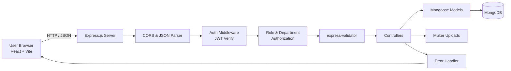
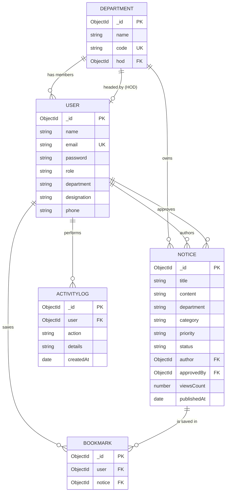

# 🎓 Department-Wise Digital Notice Board System

**FSD Project – System Design Document**

| S. No. | Student Name | Roll Number |
|:------:|--------------|-------------|
| 1 | **Ankit Kumar** | 2400320100202 |
| 2 | **Alok Kumar** | 2400320100146 |

**Project Type:** Full Stack Development (FSD)
**Project Title:** Department-Wise Digital Notice Board System
**Tech Stack:** React.js · Vite · Tailwind CSS · Node.js · Express.js · MongoDB · Mongoose · JWT · bcrypt
**🌐 Live Demo:** [https://department-wise-digital-notice-boar.vercel.app/](https://department-wise-digital-notice-boar.vercel.app/)

---

## 📑 Table of Contents

1. [Project Overview](#1-project-overview)
2. [System Architecture](#2-system-architecture)
3. [Main Modules](#3-main-modules)
4. [Database Design](#4-database-design)
5. [REST API Design](#5-rest-api-design)
6. [Recommended Development Phases](#6-recommended-development-phases)
7. [Deployment](#7-deployment)
8. [How to Run the Project](#8-how-to-run-the-project)
9. [Demo Accounts](#9-demo-accounts)

---

## 1. Project Overview

### 1.1 Introduction

The **Department-Wise Digital Notice Board System** is a full-stack web application that replaces traditional paper notice boards in colleges and universities with a secure, searchable and role-governed digital platform.

- Every academic department (CSE, ECE, Mechanical, Civil, Biotech, Management) gets its own isolated notice stream.
- Notices (circulars) are created, reviewed, approved and published entirely online.
- Students receive only the notices that are relevant to their department and campus-wide announcements.
- Urgent notices are highlighted instantly so that no important update is missed.
- The system keeps a complete audit trail of who created, approved or rejected each notice.
- The frontend is built with React.js and the backend is a RESTful API built with Node.js, Express.js and MongoDB.
- Authentication is handled with JWT tokens and passwords are protected with bcrypt hashing.

### 1.2 Background of the Problem

- In most colleges, notices are still pinned on physical boards outside departments or sent through scattered WhatsApp groups.
- Paper notices get torn, covered by newer notices or removed before students have read them.
- Students who are absent on a particular day miss critical information such as exam schedules or placement drives.
- WhatsApp groups contain a lot of unrelated chatter, so important notices get buried.
- There is no single, trusted and official source for circulars.
- Faculty members have no way to know how many students actually read a notice.
- Old notices are hard to find because there is no search or filter option.
- Printing and displaying hundreds of notices every semester wastes paper, time and money.
- There is usually no approval workflow, so incorrect or unauthorised notices can be published.
- Notices meant for one department often reach students of other departments, causing confusion.

### 1.3 Problem Statement

Colleges need a centralised digital platform where department-specific notices can be published after proper authorisation, delivered only to the intended audience, and tracked for reach and engagement, while keeping the whole process secure and auditable.

### 1.4 Proposed Solution

- A single web portal accessible from desktop, tablet and mobile browsers.
- Role-based accounts for Admin, HOD, Faculty and Students.
- A **faculty → HOD approval workflow**: notices created by faculty stay *pending* until the HOD approves them.
- Notices created by HOD or Admin are published immediately.
- Department isolation so users can only access data belonging to their own department.
- Categories, priorities and attachments for every notice.
- Powerful search, filter, sort and pagination.
- Bookmarking so students can save important notices.
- Role-specific dashboards with statistics and charts.
- Audit logs for transparency and accountability.

### 1.5 Objectives of the Project

- To eliminate dependency on paper notice boards.
- To provide a fast, reliable and official communication channel inside the campus.
- To implement strict role-based access control (RBAC).
- To ensure that notices are verified by the HOD before reaching students.
- To enable department-wise filtering of information.
- To highlight urgent notices using priority levels and visual badges.
- To allow attachments such as PDFs, Word documents and images.
- To give management visibility through analytics dashboards.
- To maintain a secure system with hashed passwords, JWT authentication and validated input.
- To build a clean, responsive and user-friendly interface.
- To follow a modular, maintainable and scalable code structure.
- To gain practical experience in full-stack development with the MERN-style stack.

### 1.6 Scope of the Project

**In scope**

- User registration, login, logout and profile management.
- Role and department assignment by Admin.
- Department management (create, view, update, delete).
- Notice creation, editing, deletion, approval and rejection.
- Attachment upload (PDF, Word, images up to 10 MB).
- Bookmarking of notices.
- Role-based dashboards for Admin, HOD, Faculty and Student.
- Search, filtering, sorting and pagination of notices.
- Audit trail of important actions.

**Out of scope (possible future work)**

- Native mobile applications.
- Real SMS and email gateway integration (the UI for alert preferences already exists).
- Push notifications.
- Multi-language notices.
- Integration with an external ERP or LMS.

### 1.7 Key Features

- 🔐 Secure login with JWT authentication.
- 👥 Four user roles with different permissions.
- 🏛️ Department isolation across notices, users and dashboards.
- ✅ HOD approval workflow for faculty notices.
- 🚨 Priority levels (low, medium, high) with urgent highlighting.
- 🗂️ Six notice categories: examination, events, placement, workshop, holiday, general.
- 📎 Multi-format attachments.
- 🔍 Instant search with advanced filters.
- 🔖 Bookmark and save notices.
- 📊 Charts and KPIs using Recharts.
- 🔔 Notification bell with unread counter.
- 🧾 Audit trail for administrative actions.
- 📱 Fully responsive layout with mobile drawer navigation.
- ⚡ 1-click demo login for quick testing.

### 1.8 Target Audience

**Primary users**

- **Students** – read approved notices of their department, track deadlines, bookmark important circulars and check the academic calendar.
- **Faculty members** – draft notices for their department, track their status and see how many students have viewed them.
- **Heads of Department (HOD)** – review the approval queue, approve or reject faculty notices and manage faculty in their department.
- **System Administrators** – manage all departments, users, roles and monitor overall system activity.

**Secondary users**

- Training and Placement cell members who share placement drives.
- Examination cell staff who publish timetables and result schedules.
- College management who need an overview of communication activity.
- Parents and guardians (future scope, read-only access).

**Audience characteristics**

- Mostly tech-comfortable students aged 17–24 who use smartphones daily.
- Faculty with moderate technical skills who need a simple, form-based interface.
- Administrators who need clear dashboards and control panels.
- Users who access the portal from both laptops and mobile phones.

### 1.9 Benefits for Each Stakeholder

**Students**

- Receive all official notices at one place.
- Never miss deadlines because of urgent badges and dashboard banners.
- Search old notices in seconds.
- Save notices for later reference.

**Faculty**

- No need to print and paste notices.
- Immediate feedback when a notice is approved or rejected.
- Reach and view statistics for every notice.

**HOD**

- Full control over what is published for the department.
- Single approval queue instead of scattered requests.
- Faculty directory and notice management in one place.

**Administration**

- Centralised control and visibility.
- Analytics on notice volume, categories and engagement.
- Complete audit logs for accountability.

**Institution**

- Reduced paper usage and printing cost.
- Improved communication and transparency.
- A modern, digital-first campus image.

### 1.10 Non-Functional Requirements

- **Security:** hashed passwords, JWT tokens, validated input, secure error handling.
- **Performance:** paginated queries and indexed database fields.
- **Scalability:** modular controllers, routes and services.
- **Usability:** clean card layouts, drawers, toasts and clear navigation.
- **Responsiveness:** works on desktop, tablet and mobile.
- **Maintainability:** separate folders for config, controllers, models, routes, middleware and utils.
- **Reliability:** centralised error handling and automated API tests.
- **Accessibility:** native `<dialog>` modals, keyboard shortcuts and readable colour contrast.

### 1.11 Assumptions and Constraints

- Every user has a valid institutional email address.
- Faculty and staff registration requires an institutional authorisation key.
- MongoDB is available locally or through a cloud service such as MongoDB Atlas.
- Attachments are limited to 10 MB per file.
- Secrets such as `JWT_SECRET` and the database URI are stored in `.env`, never in source code.

### 1.12 Expected Outcome

- A fully working, secure and responsive notice board system.
- Clear separation between frontend and backend.
- A tested REST API covering authentication, users, departments, notices, bookmarks and dashboards.
- A project that can be deployed in a real college with minimal changes.

---

## 2. System Architecture

### 2.1 Architecture Layers

| Layer | Technology | Responsibility |
|-------|-----------|----------------|
| **Presentation Layer** | React.js, Vite, Tailwind CSS, React Router DOM, Lucide Icons, Recharts | UI pages, components, routing, charts, form handling |
| **API / Application Layer** | Node.js, Express.js | REST endpoints, routing, request handling |
| **Security Layer** | JWT, bcrypt, express-validator, CORS | Authentication, role authorisation, validation, hashing |
| **Business Logic Layer** | Controllers & services | Notice workflow, approvals, dashboard statistics |
| **Data Access Layer** | Mongoose | Schemas, models, queries, aggregation |
| **Database Layer** | MongoDB | Persistent storage of users, departments, notices, bookmarks and logs |
| **File Storage** | Multer + `/uploads` | Notice attachments |

### 2.2 Architecture Flow



**Request lifecycle**

1. The user performs an action in the React interface (for example, clicks *Approve*).
2. The frontend sends an HTTP request with the `Authorization: Bearer <token>` header.
3. Express receives the request and passes it through CORS and JSON parsing.
4. The authentication middleware verifies the JWT and loads the user.
5. The authorisation middleware checks the role and department access.
6. express-validator validates the request body, params and query.
7. The controller executes the business logic.
8. Mongoose reads from or writes to MongoDB.
9. The response is returned as JSON with a proper HTTP status code.
10. The central error handler formats any error without leaking internal details.

### 2.3 Backend Folder Structure

```
backend/
├── config/
│   └── db.js                    # MongoDB connection
├── controllers/
│   ├── authController.js
│   ├── bookmarkController.js
│   ├── dashboardController.js
│   ├── departmentController.js
│   ├── noticeController.js
│   └── userController.js
├── middleware/
│   ├── auth.js                  # JWT, RBAC, department isolation
│   ├── errorHandler.js
│   ├── upload.js                # Multer (10 MB limit)
│   └── validate.js              # express-validator handler
├── models/
│   ├── ActivityLog.js
│   ├── Bookmark.js
│   ├── Department.js
│   ├── Notice.js
│   └── User.js
├── routes/
│   ├── authRoutes.js
│   ├── bookmarkRoutes.js
│   ├── dashboardRoutes.js
│   ├── departmentRoutes.js
│   ├── noticeRoutes.js
│   └── userRoutes.js
├── uploads/
├── utils/
│   ├── seed.js                  # Demo data
│   └── testApi.js               # End-to-end API tests
├── .env.example
├── package.json
└── server.js
```

### 2.4 Frontend Structure (Key Parts)

- **Pages:** Landing, Login, Register, Admin / HOD / Faculty / Student dashboards, All Notices, Notice Details, Profile.
- **Reusable components:** Navbar, Sidebar, NoticeCard, NoticeDrawer, CreateNoticeModal, StatCard, SearchBar, FilterDropdown, NotificationBell, ProfileDropdown, ProtectedRoute, Footer.
- **Routing:** React Router DOM with `ProtectedRoute` guarding role-specific pages.

---

## 3. Main Modules

### Module 1: User and Role Management

**Four primary roles**

| Role | Permissions |
|------|-------------|
| **Admin** | Full application management: users, roles, departments, all notices and dashboards |
| **HOD** | Manage notices and faculty within their own department; approve or reject faculty notices |
| **Faculty** | Create notices for their department; view and manage their own notices |
| **Student** | View approved notices of their department; bookmark notices |

**Features**

- ➢ Login / logout
- ➢ JWT authentication
- ➢ Role-based authorization
- ➢ Password change and password reset UI
- ➢ Profile management
- ➢ Department and role assignment
- ➢ Institutional key (`APEX2026`) required for faculty / staff registration

### Module 2: Department Management

- Create, view, update and delete departments.
- Fetch a department by ObjectId or code (e.g. `CSE`).
- Link an HOD to a department.
- Real-time counts of notices, faculty and students.
- Deletion is blocked while users or notices are still assigned.

### Module 3: Notice Management

- Create, view, update and delete notices.
- **Status:** `pending`, `approved`, `rejected`.
- **Priority:** `low`, `medium`, `high`.
- **Category:** `examination`, `events`, `placement`, `workshop`, `holiday`, `general`.
- Faculty notices → `pending`; HOD / Admin notices → `approved` immediately.
- HOD or Admin can approve or reject (rejection includes a reason).
- Attachment upload (PDF, Word, images, max 10 MB).
- View counter on every notice.
- Filtering by department, category, priority, status and search text, with pagination.

**Visibility rules**

| Role | Can see |
|------|---------|
| Student | Approved notices of own department + campus-wide notices |
| Faculty | Approved department notices + all of their own notices |
| HOD | All notices of their department + campus-wide notices |
| Admin | Everything |

### Module 4: Bookmark Management

- Bookmark a notice.
- Remove a bookmark.
- View all bookmarked notices with full details.
- A compound unique index prevents duplicate bookmarks.

### Module 5: Dashboard and Analytics

- **Admin:** KPIs, department-wise volume chart, category distribution chart, pending queue and audit trail.
- **HOD:** department statistics, approval queue, faculty directory.
- **Faculty:** published / pending counts, total views, own notices, department broadcasts.
- **Student:** urgent notices, latest circulars, bookmark count, upcoming events.

### Module 6: Audit and Security

- Activity log of important actions (approve, reject, create, etc.).
- Centralised error handler.
- Input validation on every endpoint.
- Department isolation middleware.

---

## 4. Database Design

### 4.1 Database Schema

**Database:** MongoDB (accessed through Mongoose)

#### User

| Field | Type | Notes |
|-------|------|-------|
| `_id` | ObjectId | Primary key |
| `name` | String | Required |
| `email` | String | Unique, required |
| `password` | String | bcrypt hash, `select: false` |
| `role` | String | `admin`, `hod`, `faculty`, `student` |
| `department` | String / ref | Department code or reference |
| `designation` | String | Optional |
| `phone` | String | Optional |
| `avatar` | String | Optional |
| `enrollmentOrEmployeeCode` | String | Roll / staff code |
| `createdAt`, `updatedAt` | Date | Timestamps |

#### Department

| Field | Type | Notes |
|-------|------|-------|
| `_id` | ObjectId | Primary key |
| `name` | String | e.g. Computer Science & Engineering |
| `code` | String | Unique, e.g. `CSE` |
| `hod` | ObjectId → User | Head of department |
| `description` | String | Optional |

#### Notice

| Field | Type | Notes |
|-------|------|-------|
| `_id` | ObjectId | Primary key |
| `title` | String | Required |
| `content` | String | Required |
| `department` | String | Department code or `All` |
| `category` | String | examination, events, placement, workshop, holiday, general |
| `priority` | String | low, medium, high |
| `status` | String | pending, approved, rejected |
| `targetAudience` | String | e.g. "2nd Year CSE Students" |
| `author` | ObjectId → User | Creator |
| `approvedBy` | ObjectId → User | Approver |
| `publishedAt` | Date | Set on approval |
| `rejectionReason` | String | Set on rejection |
| `attachments` | Array | File metadata |
| `viewsCount` | Number | Incremented on view |

#### Bookmark

| Field | Type | Notes |
|-------|------|-------|
| `_id` | ObjectId | Primary key |
| `user` | ObjectId → User | |
| `notice` | ObjectId → Notice | |
| Index | Unique (`user`, `notice`) | Prevents duplicates |

#### ActivityLog

| Field | Type | Notes |
|-------|------|-------|
| `_id` | ObjectId | Primary key |
| `user` | ObjectId → User | Who performed the action |
| `action` | String | e.g. notice approved |
| `details` | String | Description |
| `createdAt` | Date | Timestamp |

> The field lists above summarise the design. Please match them with your actual Mongoose schemas in `backend/models/` before submission.

### 4.2 ER Diagram



---

## 5. REST API Design

**Base URL:** `http://localhost:5000/api`
**Authentication:** `Authorization: Bearer <JWT_TOKEN>` (all routes except register and login)

### 5.1 Authentication – `/api/auth`

| HTTP Method | Endpoint | Purpose | Access |
|:-----------:|----------|---------|--------|
| POST | `/auth/register` | Register user | Public |
| POST | `/auth/login` | Login | Public |
| POST | `/auth/logout` | Logout | Authenticated |
| GET | `/auth/me` | Get current user profile | Authenticated |
| PUT | `/auth/profile` | Update profile | Authenticated |
| PUT | `/auth/change-password` | Change password | Authenticated |

### 5.2 Users – `/api/users`

| HTTP Method | Endpoint | Purpose | Access |
|:-----------:|----------|---------|--------|
| GET | `/users` | Get all users (paginated, searchable) | Admin, HOD (own dept) |
| GET | `/users/:id` | Get user by ID | Admin, HOD (own dept) |
| POST | `/users` | Create user | Admin |
| PUT | `/users/:id` | Update user | Admin |
| DELETE | `/users/:id` | Delete user | Admin |
| PATCH | `/users/:id/department` | Assign department | Admin |
| PATCH | `/users/:id/role` | Assign role | Admin |

### 5.3 Departments – `/api/departments`

| HTTP Method | Endpoint | Purpose | Access |
|:-----------:|----------|---------|--------|
| GET | `/departments` | Get all departments | Authenticated |
| GET | `/departments/:id` | Get department by ID or code | Authenticated |
| POST | `/departments` | Create department | Admin |
| PUT | `/departments/:id` | Update department | Admin |
| DELETE | `/departments/:id` | Delete department | Admin |

### 5.4 Notices – `/api/notices`

| HTTP Method | Endpoint | Purpose | Access |
|:-----------:|----------|---------|--------|
| GET | `/notices` | Get notices (filters, search, pagination) | Role-based |
| GET | `/notices/:id` | Get notice by ID (increments views) | Role-based |
| POST | `/notices` | Create notice | Faculty, HOD, Admin |
| PUT | `/notices/:id` | Update notice | Author, HOD, Admin |
| DELETE | `/notices/:id` | Delete notice | Author, HOD, Admin |
| PATCH | `/notices/:id/approve` | Approve notice | HOD (own dept), Admin |
| PATCH | `/notices/:id/reject` | Reject notice | HOD (own dept), Admin |
| POST | `/notices/upload` | Upload attachment | Faculty, HOD, Admin |

### 5.5 Bookmarks – `/api/bookmarks`

| HTTP Method | Endpoint | Purpose | Access |
|:-----------:|----------|---------|--------|
| POST | `/bookmarks/:noticeId` | Bookmark a notice | Authenticated |
| DELETE | `/bookmarks/:noticeId` | Remove bookmark | Authenticated |
| GET | `/bookmarks` | Get bookmarked notices | Authenticated |

### 5.6 Dashboards – `/api/dashboard`

| HTTP Method | Endpoint | Purpose | Access |
|:-----------:|----------|---------|--------|
| GET | `/dashboard/admin` | Admin statistics | Admin |
| GET | `/dashboard/hod` | HOD statistics | HOD |
| GET | `/dashboard/faculty` | Faculty statistics | Faculty |
| GET | `/dashboard/student` | Student statistics | Student |

### 5.7 Sample Request and Response

**Login – `POST /api/auth/login`**

```json
{
  "email": "sarah.jenkins@apexuniversity.edu",
  "password": "password123"
}
```

**Response `200 OK`**

```json
{
  "success": true,
  "message": "Authentication successful",
  "token": "eyJhbGciOiJIUzI1NiIsInR5cCI6IkpXVCJ9...",
  "user": {
    "id": "6745f902f4a569b91c890121",
    "name": "Dr. Sarah Jenkins",
    "email": "sarah.jenkins@apexuniversity.edu",
    "role": "hod",
    "department": "CSE",
    "designation": "Head of Department & Professor"
  }
}
```

**Create notice (Faculty) – `POST /api/notices`**

```json
{
  "title": "Machine Learning Lab Supplementary Evaluation",
  "content": "Make-up laboratory exam will be held in Room 204 on Friday at 2:00 PM.",
  "department": "CSE",
  "category": "examination",
  "priority": "high",
  "targetAudience": "2nd Year CSE Students"
}
```

**Response `201 Created`**

```json
{
  "success": true,
  "message": "Notice submitted successfully for HOD approval",
  "data": {
    "_id": "6745fa18f4a569b91c890199",
    "title": "Machine Learning Lab Supplementary Evaluation",
    "department": "CSE",
    "category": "examination",
    "priority": "high",
    "status": "pending"
  }
}
```

**Approve notice (HOD) – `PATCH /api/notices/:id/approve`**

```json
{
  "success": true,
  "message": "Notice has been approved and published",
  "data": {
    "_id": "6745fa18f4a569b91c890199",
    "status": "approved",
    "publishedAt": "2026-11-26T11:15:00.000Z"
  }
}
```

### 5.8 HTTP Status Codes Used

| Code | Meaning |
|------|---------|
| 200 | OK |
| 201 | Created |
| 400 | Validation error / bad request |
| 401 | Unauthenticated |
| 403 | Forbidden (role or department violation) |
| 404 | Resource not found |
| 409 | Conflict (e.g. duplicate bookmark / email) |
| 500 | Internal server error |

---

## 6. Recommended Development Phases

| Phase | Development | Duration |
|:-----:|-------------|----------|
| 1 | Requirements analysis and UI design | 2 days |
| 2 | Frontend development (pages, components, routing, charts) | 1 week |
| 3 | Authentication and user management (JWT, RBAC, roles) | 1 week |
| 4 | Department, notice, bookmark and dashboard APIs | 1 week |
| 5 | Frontend–backend integration | 3 days |
| 6 | Testing and deployment | 2 days |

> Durations are estimates. Adjust them to match your actual project timeline.

---

## 7. Deployment

| Part | Platform | Link |
|------|----------|------|
| Frontend (React + Vite) | Vercel | [department-wise-digital-notice-boar.vercel.app](https://department-wise-digital-notice-boar.vercel.app/) |

You can use the 1-click demo buttons on the login page of the live site to try each role (Admin, HOD, Faculty, Student).

---

## 8. How to Run the Project

### Prerequisites

- Node.js (LTS) and npm
- MongoDB (local or Atlas)

### Backend

```powershell
cd backend
npm install
copy .env.example .env      # then fill in MONGO_URI and JWT_SECRET
npm run seed                # seed demo departments, users and notices
npm start                   # or: npm run dev
```

Server runs at **http://localhost:5000**

Run automated API tests:

```powershell
npm test
```

### Frontend

```powershell
cd frontend
npm install
npm run dev
```

Open **http://localhost:5173/**

Production build check:

```powershell
npm run build
npm run preview
```

> **Tip (Windows):** if port 5000 is stuck, free it with:
> `Stop-Process -Id (Get-NetTCPConnection -LocalPort 5000).OwningProcess -Force`

### Environment Variables (`backend/.env`)

```
PORT=5000
MONGO_URI=<your MongoDB connection string>
JWT_SECRET=<a long random secret>
JWT_EXPIRES_IN=7d
```

---

## 9. Demo Accounts

All demo accounts use the password `password123`.

| Role | Name | Email | Department |
|------|------|-------|-----------|
| Super Admin | Dr. Alistair Vance | `admin@apexuniversity.edu` | All |
| HOD | Dr. Sarah Jenkins | `sarah.jenkins@apexuniversity.edu` | CSE |
| Faculty | Prof. Rajiv Sharma | `rajiv.sharma@apexuniversity.edu` | CSE |
| Student | Danielle Attah | `danielle.attah@student.apex.edu` | CSE |

> ⚠️ These credentials are for demo and testing only. Change them before any real deployment.

---

## 🙌 Team

- **Ankit Kumar** – 2400320100202
- **Alok Kumar** – 2400320100146
